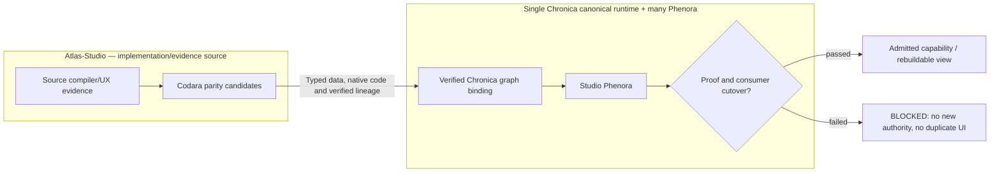

# Atlas Studio

## Canonical Ynventa/Chronica integration — registered Latin nomenclature

**One Digital Holobiont.** Canonical concept names belong to [Chronica's 21-concept registry](https://github.com/llgtrn/Chronica/blob/main/.ynventa/declared/nomenclature/concepts.jsonl) (DECISION 0115). **Genora** = inherited graph/identity laws; **Codara** = typed semantic intents; **Ontogen** = lawful capability pathway composition; **Myelion** = mathematical evaluation located with native capabilities (no independent module); **Axora** = verified external bindings; **Thymora** = authority; **Porion** = pre-effect admission; **Metabion** = bounded execution; **Lineara** = evidence; **Phenora** = observable, rebuildable expression. Norl and Chronica retain their product/host identities. Generic biological words explain functions but are not competing proper names or invitations to create a new crate.

**This checkout's contribution:** This repository is frozen source/donor material for verified capabilities. **Codara** is the canonical semantic-language concept and implementation under Chronica, not a promise that every compiler source here was absorbed. The Studio frontend in `apps/studio` must converge into the common Chronica Phenora without duplicating UI ownership, while unique semantics and proof fixtures preserve identity and behavior.

**ONE body, MANY Phenora, ONE product-UI code owner.** All frontends, dashboards, charts, studios and operator UI eventually reside under `Chronica/phenotype/`; native algorithms and typed contracts can remain specialized capability implementations until converged. One common physical source grammar applies to all eight repositories including ECDEV; current old source roots are **migration inputs** and have no permanent architectural exemption. A README is not evidence that code migration, protocol relock, user-interface cutover or V1 completion has occurred. [Architecture](https://github.com/llgtrn/.Ynventa-/blob/main/BLUEPRINT-V1.md) · [Morphology](https://github.com/llgtrn/.Ynventa-/blob/main/REPOSITORY-PROTOCOL-V1.md) · [Concept vocabulary](https://github.com/llgtrn/.Ynventa-/blob/main/SEMANTIC-MODEL-V1.md).

## Execution model — subsystem first, IDE later

The existing source code was designed as a tool/runtime subsystem; its verified technology must be reconciled with the canonical Codara implementation inside Chronica.

A first-class target is an embedded coding-agent session:

~~~text
Claude Code / another coding agent
        ↓ local MCP / API adapter
Atlas Core in the same outer sandbox
        ↓
candidate workspaces + Census + verification + admission
        ↓
Verified typed candidate → Chronica Codara/graph, after proof
~~~

The cloud coding session may supply compute, checkout and an outer sandbox. Atlas still owns semantic identity, uncertainty/closure, candidate verification and admission. A mutable agent worktree is candidate state until admitted.

MCP is an agent-facing transport, not a second semantic authority. Studio presentation must be owned by Chronica Phenora; only verified native source algorithms and contracts can survive independently.

Ephemeral agent context is not project memory. Sealed Atlas artifacts and their evidence/lineage are the durable machine-readable engineering state that a later session can load and incrementally recensus.

See the contract `.atlas/contracts/AGENT-HOST-EMBEDDED-RUNTIME.md`, now Ynventa knowledge (`ynventa fact list --subject .atlas/contracts/AGENT-HOST-EMBEDDED-RUNTIME.md`).

## Multi-AI construction

A typed Codara candidate may be constructed by bounded agents, but the swarm is never the authority or durable memory of the project.

~~~text
Atlas ConstructionTaskGraph
        ↓
ProviderRouter
├─ host-native coding/subagents
├─ remote AI providers
├─ Jev-class decision providers
├─ local/self-hosted models
└─ remote Atlas/deterministic workers
        ↓
typed Atlas blackboard + CandidateAtlas branches
        ↓
verify / compare / repair
        ↓
authorized selection / admission / seal
~~~

The first embedded host may be Claude-oriented while Atlas still routes admitted tasks to GPT/Gemini/Jev/other providers or remote Atlas workers. Provider choice is execution routing, not semantic truth.

Agents receive bounded task/capability leases and task-specific semantic context slices. Their conversations are not project memory. Jev emits typed decision proposals; it does not own SelectedDesign. Provider consensus cannot bypass verification, AdmissionTransaction or seal.

See the contract `.atlas/contracts/MULTI-AI-CONSTRUCTION-FABRIC.md`, now Ynventa knowledge.

## Core invariants

- `.ynventa/` is the only knowledge authority (typed facts, never Markdown; `ynventa context`, `ynventa knowledge view`). It is this shard's protocol projection only (`protocol.lock`, `declared/`, `knowledge/`): the Ynventa engine is central (the sibling checkout `.Ynventa-`) and interprets the shard through `protocol.lock`; no engine source is ever added under `.ynventa/`. Run it from the shard root as `cargo run -q --manifest-path ../.Ynventa-/Cargo.toml --bin ynventa -- <cmd> --root .` (or the built `../.Ynventa-/target/release/ynventa <cmd> --root .`); `tools/atlas/` is the Atlas control root (manifest, declared architecture, self-build ledgers and their evidence); `*.atlas` is a dense binary engineering artifact. The `.atlas/` directory is retired (ADR 0104, a DECISION fact).
- Every admitted artifact and discovered function is accounted for. UNKNOWN is permitted only explicitly; silent omission is forbidden.
- Universal graph primitives include identity, scope, node, edge, binding, state, event, temporal, evidence, provenance, constraint/invariant, interface/capability, effect and materialization.
- Source repositories remain temporary development checkouts; Chronica owns the single sovereign semantic graph and authorization.
- Logical Atlas may be physically sharded across locations without becoming multiple truth systems.
- Completeness outranks file size; semantic interning/dedup/deltas/compression reduce duplication rather than delete meaning.
- AtlasX is selected executable representation, not prose.
- Compiler optimization begins at world/graph level and continues through machine code, LTO, post-link, PGO and evidence-backed auto-tuning.
- Backend/compiler/runtime bootstrap is Rust. Canonical frontend bootstrap is TypeScript/TSX inside Chronica/phenotype ONLY. C is an explicit low-level boundary by default.
- Donor OSS is evidence/reference and is removed from the temporary workbench after native absorption proof.

The physical source binary identifiers `atlas-systemizer` and `atlas.systemizer.cli.v1` remain source-code locators for comparison and must not be described as current canonical subsystem names.
