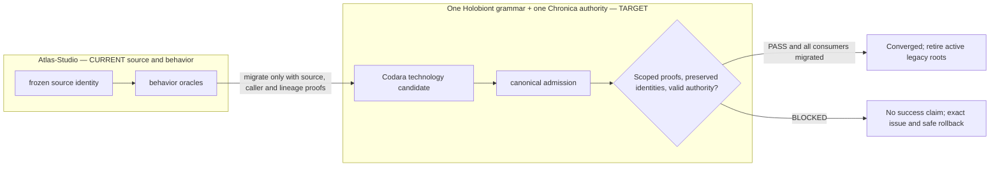

# Atlas Studio


## UI ownership — one Chronica Phenotype, biological roles (owner instruction 2026-10-14)

**Binding target; current-source exceptions remain unfinished migrations.** All eight Ynventa repositories share one root vocabulary, but **only Chronica/phenotype/** may own durable user-facing UI source code. The one-organism principle forbids eight parallel dashboards, studios, frontends, business-rule engines and design systems. A capability owner supplies verified native technology, typed graphs, data contracts and evidence. The biological word `Phenotype` means *observable expression*, never canonical truth; `Phenome` is the aggregation of observations; `Regulome`, `Epigenome`, `Proteome`, `Interactome` and `Metabolome` are **semantic views**, not licenses to create new roots or databases.

**Repository-specific rule:** `apps/studio/` and its TypeScript/TSX presentation are **frozen source material for UI migration**, not a second permanent design application. Audit Studio components, import graph, design tokens and user flows; reuse or move only justified unique UI behavior into `Chronica/phenotype/`, then delete the old frontend after verified consumers switch. Historical semantic compiler algorithms must be evaluated under Codara/Chronica with source-lineage and proof; a similar name is not parity evidence.

**Biological function mapping:** Transcriptome: Codara typed semantic programs; Interactome: verified capability graphs; Phenotype: Chronica Studio, not this repository; Evolution: source/donor algorithms with frozen provenance.

**How to comply:** Before adding frontend or an organ, look up existing Chronica capability ownership, `phenotype/chart-view`, design/rendering primitives and semantic contract. Reuse if equivalent. For truly new presentation work, assign the **only UI write lease** to Chronica. For an existing UI, perform source/caller census → independent behavior/authorization tests → move/compose into Chronica → redirect consumers → delete old frontend/build paths → eight-repository anti-duplication scan. A failed stage remains BLOCKED, never counted as merged. An HTTP API, research-only web parser or headless simulation is NOT a user interface by itself.

Documentation of this target does not change current code or imply 8/8 conformance. Authoritative descriptions: [Biological Ontology](https://github.com/llgtrn/.Ynventa-/blob/main/SEMANTIC-MODEL-V1.md), [Single Phenotype Blueprint](https://github.com/llgtrn/.Ynventa-/blob/main/BLUEPRINT-V1.md), [UI ownership placement](https://github.com/llgtrn/.Ynventa-/blob/main/REPOSITORY-PROTOCOL-V1.md).


## Universal Ynventa source morphology — binding owner target (2026-10-14)

**Owner-approved final architecture, NOT a claim of completed source migration.** All eight checkouts — **Chronica, .Ynventa-, Esellios, Fi-game, Mechatron, Atlas-Studio, Universal-Connector, ECDEV** — must use ONE root vocabulary: genome/, physiology/, organism/, membrane/, symbiosis/, phenotype/, evolution/, assays/ and .ynventa/, instantiated only where needed. The current engine still has Host/Guest grammar branching. The owner rejects that distinction as a **permanent physical layout rule**; Chronica remains the sole semantic/authority host, not a filesystem exception. ECDEV is a mandatory eighth repository; its independent .ecdev protocol must be assimilated without destroying provenance. Read the [universal Repository Protocol](https://github.com/llgtrn/.Ynventa-/blob/main/REPOSITORY-PROTOCOL-V1.md) before a structural cutover.

**Repository-specific assessment:** Independent compiler/organism claims in the historical README are donor intent, not an independent permanent authority. Map real algorithms to Codara and the canonical graph only after scoped parity proof.



**Status and scope:** Legacy directories, commands and architectural descriptions retained below describe a dated current-code or historical donor implementation; **they are not alternative normative grammars**. The target requires the same .ynventa declaration/evidence model for all eight, one pinned schema+engine epoch, removal of deprecated implementation roots/validators and a reproducible **8/8** conformance certificate. Nothing in this README is proof that migration, extinction or a production effect has already passed.


Atlas Studio is a product-neutral engineering-world compiler and system invention environment.

Digital Organism is a first-class Atlas target, but [HISTORICAL INTENT, superseded as Ynventa governance] Atlas was designed to be independent of generated systems; under the current owner directive this checkout is temporary source material for one canonical Chronica universe. An organism may use external LLM/model APIs, self-hosted models, deterministic cognition or hybrid bindings; weights are optional organs, not the organism itself.

It performs strict, evidence-linked census from multi-repository scope down to every discovered function and required semantic atom; reconciles gaps/conflicts to a fixed point; synthesizes and validates target-native designs; publishes them as a dense logical `*.atlas`; materializes selected executable worlds as `*.atlasx/`; and compiles them into verified target products.

```text
Reality / repositories / donors / research
        ↓
strict census + CensusCertificate
        ↓
observed/research/invention graph
        ↓
SEALED logical *.atlas
        ↓
content-addressed shards when needed
        ↓
deterministic *.atlasx/
        ↓
world/semantic optimization
        ↓
HIR → MIR → LIR → Machine IR
        ↓
codegen → LTO → link → post-link
        ↓
binary / library / WASM / UI product
        ↓
runtime profiling / PGO / auto-tuning
        ↺
evidence + recensus
```

## Execution model — subsystem first, IDE later

Atlas Core is designed to run as a tool/runtime subsystem inside the environment where engineering is already happening.

A first-class target is an embedded coding-agent session:

~~~text
Claude Code / another coding agent
        ↓ local MCP / API adapter
Atlas Core in the same outer sandbox
        ↓
candidate workspaces + Census + verification + admission
        ↓
SEALED logical Atlas → canonical *.atlas
~~~

The cloud coding session may supply compute, checkout and an outer sandbox. Atlas still owns semantic identity, uncertainty/closure, candidate verification and admission. A mutable agent worktree is candidate state until admitted.

MCP is an agent-facing adapter, not Atlas's canonical semantic protocol. The same Atlas Core is intended to serve CLI, CI/API integrations and a future Atlas Studio IDE without creating parallel truth systems.

Ephemeral agent context is not project memory. Sealed Atlas artifacts and their evidence/lineage are the durable machine-readable engineering state that a later session can load and incrementally recensus.

See the contract `.atlas/contracts/AGENT-HOST-EMBEDDED-RUNTIME.md`, now Ynventa knowledge (`ynventa fact list --subject .atlas/contracts/AGENT-HOST-EMBEDDED-RUNTIME.md`).

## Multi-AI construction

A canonical `*.atlas` may be constructed by a heterogeneous AI/tool swarm, but the swarm is never the authority or durable memory of the project.

~~~text
Atlas ConstructionTaskGraph
        ↓
ProviderRouter
├─ host-native coding/subagents
├─ remote AI providers
├─ Jev-class decision providers
├─ local/self-hosted models
└─ remote Atlas/deterministic workers
        ↓
typed Atlas blackboard + CandidateAtlas branches
        ↓
verify / compare / repair
        ↓
authorized selection / admission / seal
~~~

The first embedded host may be Claude-oriented while Atlas still routes admitted tasks to GPT/Gemini/Jev/other providers or remote Atlas workers. Provider choice is execution routing, not semantic truth.

Agents receive bounded task/capability leases and task-specific semantic context slices. Their conversations are not project memory. Jev emits typed decision proposals; it does not own SelectedDesign. Provider consensus cannot bypass verification, AdmissionTransaction or seal.

See the contract `.atlas/contracts/MULTI-AI-CONSTRUCTION-FABRIC.md`, now Ynventa knowledge.

## Core invariants

- `.ynventa/` is the only knowledge authority (typed facts, never Markdown; `ynventa context`, `ynventa knowledge view`). It is this shard's protocol projection only (`protocol.lock`, `declared/`, `knowledge/`): the Ynventa engine is central (the sibling checkout `.Ynventa-`) and interprets the shard through `protocol.lock`; no engine source is ever added under `.ynventa/`. Run it from the shard root as `cargo run -q --manifest-path ../.Ynventa-/Cargo.toml --bin ynventa -- <cmd> --root .` (or the built `../.Ynventa-/target/release/ynventa <cmd> --root .`); `tools/atlas/` is the Atlas control root (manifest, declared architecture, self-build ledgers and their evidence); `*.atlas` is a dense binary engineering artifact. The `.atlas/` directory is retired (ADR 0104, a DECISION fact).
- Every admitted artifact and discovered function is accounted for. UNKNOWN is permitted only explicitly; silent omission is forbidden.
- Universal graph primitives include identity, scope, node, edge, binding, state, event, temporal, evidence, provenance, constraint/invariant, interface/capability, effect and materialization.
- Independently generated repositories remain sovereign but cross-repository composable through stable identities/bindings.
- Logical Atlas may be physically sharded across locations without becoming multiple truth systems.
- Completeness outranks file size; semantic interning/dedup/deltas/compression reduce duplication rather than delete meaning.
- AtlasX is selected executable representation, not prose.
- Compiler optimization begins at world/graph level and continues through machine code, LTO, post-link, PGO and evidence-backed auto-tuning.
- Backend/compiler/runtime bootstrap is Rust. Frontend bootstrap is TypeScript/TSX. C is an explicit low-level boundary by default.
- Donor OSS is evidence/reference and is removed from the temporary workbench after native absorption proof.

The current compatibility binary remains `atlas-systemizer` and API `atlas.systemizer.cli.v1` while the native Atlas compiler/runtime is built.
