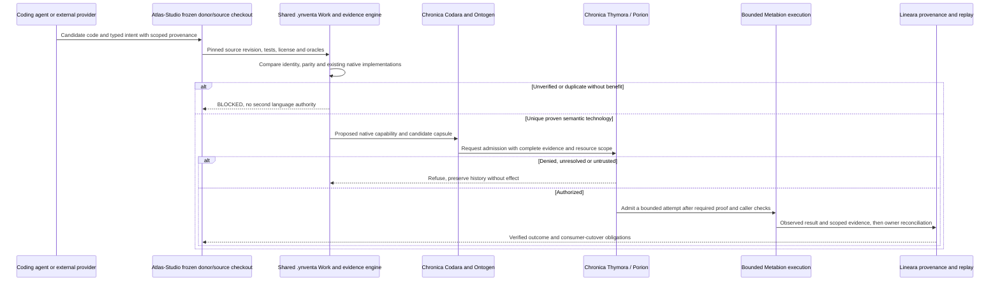
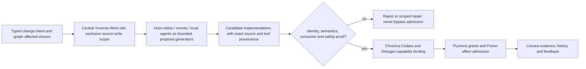

# Atlas Studio

**Reference:** [Chronica's registered 21-concept function/architecture atlas](https://github.com/llgtrn/.Ynventa-/blob/main/NOMENCLATURE-ARCHITECTURE-ATLAS.md) explains every current Latin-inspired concept, its exact boundaries and implementation status; the authority is still Chronica's canonical nomenclature registry, not this README.

## Canonical Ynventa/Chronica integration — registered Latin nomenclature

**One Digital Holobiont.** Canonical concept names belong to [Chronica's 21-concept registry](https://github.com/llgtrn/Chronica/blob/main/.ynventa/declared/nomenclature/concepts.jsonl) (DECISION 0115). **Genora** = inherited graph/identity laws; **Codara** = typed semantic intents; **Ontogen** = lawful capability pathway composition; **Myelion** = mathematical evaluation located with native capabilities (no independent module); **Axora** = verified external bindings; **Thymora** = authority; **Porion** = pre-effect admission; **Metabion** = bounded execution; **Lineara** = evidence; **Phenora** = observable, rebuildable expression. Norl and Chronica retain their product/host identities. Generic biological words explain functions but are not competing proper names or invitations to create a new crate.

**This checkout's contribution:** This repository is frozen source/donor material for verified capabilities. **Codara** is the canonical semantic-language concept and implementation under Chronica, not a promise that every compiler source here was absorbed. The Studio frontend in `apps/studio` must converge into the common Chronica Phenora without duplicating UI ownership, while unique semantics and proof fixtures preserve identity and behavior.

**ONE body, MANY Phenora, ONE product-UI code owner.** All frontends, dashboards, charts, studios and operator UI eventually reside under `Chronica/phenotype/`; native algorithms and typed contracts can remain specialized capability implementations until converged. One common physical source grammar applies to all eight repositories including ECDEV; current old source roots are **migration inputs** and have no permanent architectural exemption. A README is not evidence that code migration, protocol relock, user-interface cutover or V1 completion has occurred. [Architecture](https://github.com/llgtrn/.Ynventa-/blob/main/BLUEPRINT-V1.md) · [Morphology](https://github.com/llgtrn/.Ynventa-/blob/main/REPOSITORY-PROTOCOL-V1.md) · [Concept vocabulary](https://github.com/llgtrn/.Ynventa-/blob/main/SEMANTIC-MODEL-V1.md).

```mermaid
flowchart LR
    subgraph SOURCE["Atlas-Studio: current development and migration input"]
      A["Source compiler / design evidence"] --> B["Codara parity candidates"]
    end
    B -. "PROPOSED migration; runtime join NOT YET PROVEN" .-> V{"Independent identity, behavior, authority and consumer proof"}
    V -. "candidate only; evidence grants no authority" .-> C["One Chronica world: verified target binding"]
    subgraph CANON["Required governed relationships; these dashed edges are not source integration calls"]
      C -. "typed WorkRequest and current authority" .-> P["Thymora / Porion: pre-effect admission"]
      P -. "sealed plan and bounds" .-> M["Metabion: bound execution"]
      M -. "success, failure or unknown effect" .-> L["Lineara: evidence, reconciliation and canonicalization"]
      L -. "accepted canonical event" .-> H["One history; replay-derived World"]
      H -. "derived permitted projection" .-> F["Studio / compiler Phenora; shared UI at Chronica/phenotype"]
    end
```

## Source execution and convergence — Codara, not an independent Atlas authority

**The existing repository is a temporary development/source checkout.** Codara is the named canonical semantic-intent capability in Chronica, with real implementation under `physiology/capability/codara` and a governed `phenotype/codara` CLI. Similar historical names are not proof that this checkout's compiler code has been absorbed. Retain source identity, candidate artifacts, oracles, licenses and performance data, but do not describe this repository as owning semantic truth, permission, canonical admission, or a permanent independent coding environment.

A coding-agent session can call a locally bounded MCP/API adapter while preparing **candidate artifacts**. Those source artifacts and tests remain scoped and non-authoritative until Chronica graph/capability verification, Thymora/Porion admission and Lineara evidence accept the specified behavior. Remote providers, including coding agents, may make proposals; neither consensus nor an independent local `Atlas Core` can authorize changes to the body.

**PROPOSED convergence interaction, not an implemented source-to-Chronica call trace.** The sequence expresses required review/authority/evidence obligations; it does not establish automatic central-engine admission or actual consumer cutover.

## Agent construction and provider routing

Multi-agent construction is an **orchestration implementation concern**, not a new species, a second canonical graph, or an autonomous programming authority. Coding sessions receive bounded Work/Lease/Result contracts, pinned read/write sets and narrowly scoped semantic context. Any former in-checkout task graph, blackboard or provider router must be **classified as source technology**, compared with the central evolution machinery and absorbed only when independently useful.

**PROPOSED construction relationships, not a current integrated runtime.** Actual source-local agent tooling and central Work mechanisms must be verified separately.

The historical `tools/atlas/` and `*.atlas` filenames are **existing source/evidence locators**, not canonical subsystem branding or a second approved control plane. Only machine-readable identifiers explicitly frozen in the registry policy are preserved as data; canonical architecture and UI ownership are Chronica-wide. The Studio at `apps/studio` remains migration source until its unique UI functionality moves into Chronica Phenora, verified consumers switch and its independent bundle is retired.

## Core invariants

- `.ynventa/` is the only knowledge authority (typed facts, never Markdown; `ynventa context`, `ynventa knowledge view`). It is this shard's protocol projection only (`protocol.lock`, `declared/`, `knowledge/`): the Ynventa engine is central (the sibling checkout `.Ynventa-`) and interprets the shard through `protocol.lock`; no engine source is ever added under `.ynventa/`. Run it from the shard root as `cargo run -q --manifest-path ../.Ynventa-/Cargo.toml --bin ynventa -- <cmd> --root .` (or the built `../.Ynventa-/target/release/ynventa <cmd> --root .`); `tools/atlas/` is a source-code control/evidence locator from the previous implementation (not an authority or an approved destination root); `*.atlas` is a dense binary engineering artifact. The `.atlas/` directory is retired (ADR 0104, a DECISION fact).
- Every admitted artifact and discovered function is accounted for. UNKNOWN is permitted only explicitly; silent omission is forbidden.
- Universal graph primitives include identity, scope, node, edge, binding, state, event, temporal, evidence, provenance, constraint/invariant, interface/capability, effect and materialization.
- Source repositories remain temporary development checkouts; Chronica owns the single sovereign semantic graph and authorization.
- Physical source checkouts may be distributed; their code and evidence converge into Chronica's **one** semantic and authority universe.
- Completeness outranks file size; semantic interning/dedup/deltas/compression reduce duplication rather than delete meaning.
- Source compiler artifacts can provide candidate executable representations; their semantics and native ownership require Codara parity proof, real callers and authorized Chronica admission.
- Optimization may use graph-level semantics and native compiler techniques such as LTO or PGO only when the specific implementation, production caller and reproducible benchmark establish a benefit; no unimplemented optimizer is implied.
- Backend/compiler/runtime bootstrap is Rust. Canonical frontend bootstrap is TypeScript/TSX inside Chronica/phenotype ONLY. C is an explicit low-level boundary by default.
- Donor OSS is evidence/reference and is removed from the temporary workbench after native absorption proof.

The physical source binary identifiers `atlas-systemizer` and `atlas.systemizer.cli.v1` remain source-code locators for comparison and must not be described as current canonical subsystem names.
