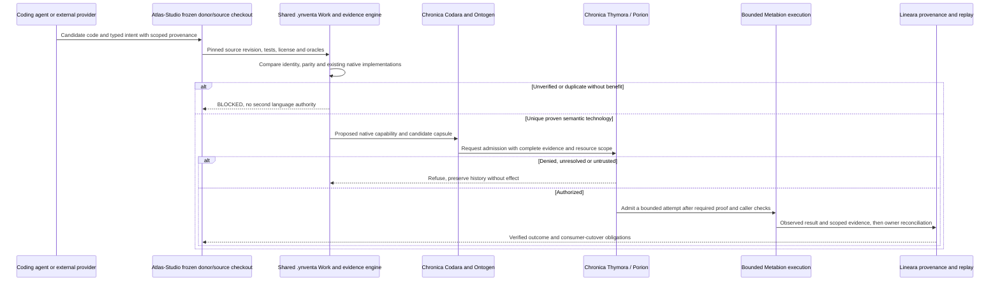
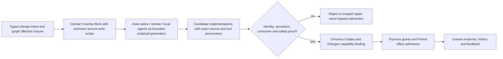

# Atlas Studio

**Architecture reference:** Read the [full Blueprint](https://github.com/llgtrn/.Ynventa-/blob/main/BLUEPRINT-V1.md) for the complete design under explicit owner instructions and applicable accepted decisions. The [nomenclature architecture atlas](https://github.com/llgtrn/.Ynventa-/blob/main/NOMENCLATURE-ARCHITECTURE-ATLAS.md) is derived navigation for currently registered names and bindings, not the full architecture or a ceiling on its requirements. Proposals retain their recorded status; a design requirement alone neither registers an identity nor proves implementation.

## Full V1 native operating organism — owner decision

The explicit owner decision of **2026-10-16 16:43:08 UTC**, “FULL V1 NATIVE OPERATING
ORGANISM. NO SCOPE REDUCTION,” defines Chronica V1 as one graph-native Digital Intelligence
Holobiont Operating System. It must boot and operate independently on one certified hardware
target, with no mandatory Linux or Windows kernel/runtime. Linux is development, bootstrap and
test infrastructure. A hosted application, container, daemon or passing software suite cannot
establish native OS completion.

All nine product journeys and P0–P3 remain in V1; the phases only order dependencies and work.
Native protection, scheduling, interrupts, boot, authority and recovery must operate when
cognition is unavailable. Norl/Neurora require real models, weights and inference. Governed
offspring have distinct organism identities within the same canonical World.

The [source contribution and acceptance guidance](tools/atlas/contracts/NATIVE-V1-SOURCE-CONTRIBUTION.md)
separates this required target from current Atlas source and unqualified gaps. The published
[Native OS V1 Completion Contract, Blueprint §61](https://github.com/llgtrn/.Ynventa-/blob/08d412aa310f2508b215fbe9c9b025e58119af8b/BLUEPRINT-V1.md#61-full-native-v1-operating-organism-completion-contract)
pins the [Chronica responsibility crosswalk](https://github.com/llgtrn/Chronica/commit/65bcd2693f9afd40ce8f3a0cb876182c90ed254e):
DECISION 0180 accepts owner scope; DECISION 0181's kernel/hardware mechanisms remain PROPOSED.
Publication does not select or certify hardware, a kernel or a model. Remaining bindings for the
complete native product, physical journey evidence and a full-scope acceptance producer are missing.
The owner's **2026-10-16 18:34 UTC** direction to continue until full V1 supersedes the
16:43:08 documentation-only implementation pause. Bounded implementation and publication resume
under the accepted full-native scope; the earlier STOP evidence remains historical and unchanged.
This Atlas lane repairs the [compatibility producer](tools/atlas/evidence/verification/current-schema-compatibility/README.md)
first (`OBL-SELF-COMPATIBILITY-SCHEMAS`, supporting N11/J8), then resumes artifact/caller cutover.
Product UI ownership remains exclusively Chronica/Phenora; Atlas source UI remains frozen.

## Canonical Ynventa/Chronica integration — registered Latin nomenclature

**One Digital Holobiont.** [Chronica's nomenclature registry](https://github.com/llgtrn/Chronica/blob/main/.ynventa/declared/nomenclature/concepts.jsonl) and [frozen-form policy](https://github.com/llgtrn/Chronica/blob/main/.ynventa/declared/nomenclature/policy.jsonl) provide admitted stable names, identities and current declared bindings (DECISION 0115); their current entry count does not limit the Blueprint's design scope or prove executable bindings. **Norl is cognition hosted within Chronica.** Chronica owns canonical identity, history, authority and governed execution. Generic biological words explain functions without creating competing identities, implementation homes or permission.

**Neurora status:** [CN-0026 registration](https://github.com/llgtrn/Chronica/blob/09ce89f847628db531c42759c2cbcf880071c3bd/.ynventa/declared/nomenclature/concepts.jsonl) names Neurora with implementation status **REQUIRED_MISSING** and semantic home `norl.cognition`. AGNC (Adaptive Graph of Neural Cores) remains a required computational architecture inside Neurora, not an exact global synonym or a retired technical term. Registration creates no module, directory, service, execution binding or authority; existing Norl cognition is a foundation only.

**This checkout's contribution:** This repository is temporary source/donor material. **Codara** is the canonical semantic-language concept and implementation under Chronica, not a promise that every compiler source here was absorbed. `apps/studio` contains historical placeholder metadata and design tokens, not an executable frontend or route-parity oracle. Preserve that evidence and unique source semantics; all new product UI is owned exclusively by `Chronica/phenora/`.

**ONE body, MANY Phenora, ONE product-UI code owner.** The canonical residence rename to [`Chronica/phenora/`](https://github.com/llgtrn/Chronica/tree/65bcd2693f9afd40ce8f3a0cb876182c90ed254e/phenora) is complete. All product frontends, dashboards, charts, studios and operator UI belong there; Atlas source retirement and verified consumer cutover remain pending. Native algorithms and typed contracts can remain specialized capability implementations until converged. One common physical source grammar applies to all eight repositories including ECDEV; current old source roots are **migration inputs** and have no permanent architectural exemption. A README is not evidence that code migration, protocol relock, user-interface cutover or V1 completion has occurred. [Architecture](https://github.com/llgtrn/.Ynventa-/blob/main/BLUEPRINT-V1.md) · [Morphology](https://github.com/llgtrn/.Ynventa-/blob/main/REPOSITORY-PROTOCOL-V1.md) · [Concept vocabulary](https://github.com/llgtrn/.Ynventa-/blob/main/SEMANTIC-MODEL-V1.md).

```mermaid
flowchart LR
    subgraph SOURCE["Atlas-Studio: current development and migration input"]
      A["Source compiler / design evidence"] --> B["Codara parity candidates"]
    end
    B -. "PROPOSED migration; runtime join NOT YET PROVEN" .-> V{"Independent identity, behavior, authority and consumer proof"}
    V -. "candidate only; evidence grants no authority" .-> C["One Chronica world: verified target binding"]
    subgraph CANON["Required governed relationships; these dashed edges are not source integration calls"]
      C -. "typed WorkRequest and current authority" .-> P["Thymora / Porion: pre-effect admission"]
      P -. "sealed plan and bounds" .-> M["Metabion: bound execution"]
      M -. "success, failure or unknown effect" .-> L["Lineara: evidence, reconciliation and canonicalization"]
      L -. "accepted canonical event" .-> H["One history; replay-derived World"]
      H -. "derived permitted projection" .-> F["Studio / compiler Phenora; shared UI at Chronica/phenora"]
    end
```

## Source execution and convergence — Codara, not an independent Atlas authority

The ADL source compiler resides at `core/src/codara`, exposed as `atlas_core::codara::adl`
within the existing `core` package. Its parser, compiler and census bridge retain their
algorithms and wire contracts. Active Rust callers use this namespace without a `language`
alias. This bounded source naming slice establishes no Chronica grammar parity, native
absorption or runtime admission.

| Historical source locator | Current source locator |
|---|---|
| `core/src/language/mod.rs` | `core/src/codara/mod.rs` |
| `core/src/language/adl/mod.rs` | `core/src/codara/adl/mod.rs` |
| `core/src/language/adl/census.rs` | `core/src/codara/adl/census.rs` |
| `core/src/language/adl/census/tests.rs` | `core/src/codara/adl/census/tests.rs` |

The four files moved byte-for-byte with their saved-workspace ArtifactIds. Historical
observations keep their original IDs and locators; `atlas.adl.*` schemas, source-span data,
the census derivation ID and `tools/atlas/declared/census.adl` remain unchanged.

The target-neutral construction IR and pure Rust string emitter now reside at
`atlas_core::codara::construction`, with the same three saved-workspace ArtifactIds:

| Historical source locator | Current source locator |
|---|---|
| `core/src/construction/mod.rs` | `core/src/codara/construction/mod.rs` |
| `core/src/construction/rust.rs` | `core/src/codara/construction/rust.rs` |
| `core/src/construction/tests.rs` | `core/src/codara/construction/tests.rs` |

The three files remain byte-identical. Current callers use the new namespace without an alias;
construction still reads only census records, design and comparison inputs, retains explicit
gaps, and separates source oracles from construction. Runtime still validates the lifted IR
before emitting it. Historical `atlas.construction.*` schemas, identity preimages, fixture
objects, generated text and past observations are unchanged. Current oracle imports follow the
current census module path; this move does not rewrite or rebind historical census records.
Chronica integration still needs a native semantic/IR mapping, an actual admitted caller and
bounded result evidence; this source namespace supplies none of those target contracts.

**The existing repository is a temporary development/source checkout.** Codara is the named canonical semantic-intent capability in Chronica, with a pure library at [`codara/`](https://github.com/llgtrn/Chronica/blob/65bcd2693f9afd40ce8f3a0cb876182c90ed254e/codara/Cargo.toml) (package `capability-codara`) and a governed [`phenora/codara/`](https://github.com/llgtrn/Chronica/blob/65bcd2693f9afd40ce8f3a0cb876182c90ed254e/phenora/codara/Cargo.toml) CLI (package `codara`). Similar historical names are not proof that this checkout's compiler code has been absorbed. Retain source identity, candidate artifacts, oracles, licenses and performance data, but do not describe this repository as owning semantic truth, permission, canonical admission, or a permanent independent coding environment.

A coding-agent session can call a locally bounded MCP/API adapter while preparing **candidate artifacts**. Those source artifacts and tests remain scoped and non-authoritative until Chronica graph/capability verification, Thymora/Porion admission and Lineara evidence accept the specified behavior. Remote providers, including coding agents, may make proposals; neither consensus nor an independent local `Atlas Core` can authorize changes to the body.

The six-file historical `.atlas` census-container reader, writer, typed encoding and schema
history now reside at `atlas_core::codara::artifact::census_container`. This is artifact
serialization; census observation, seal authority and runtime filesystem work keep their
existing owners. All six files and their encoded fixtures/history moved byte-for-byte with
preserved saved-workspace ArtifactIds:

| Historical source locator | Current source locator |
|---|---|
| `core/src/atlas/mod.rs` | `core/src/codara/artifact/census_container/mod.rs` |
| `core/src/atlas/schema.rs` | `core/src/codara/artifact/census_container/schema.rs` |
| `core/src/atlas/schema_history.rs` | `core/src/codara/artifact/census_container/schema_history.rs` |
| `core/src/atlas/typed.rs` | `core/src/codara/artifact/census_container/typed.rs` |
| `core/src/atlas/tests.rs` | `core/src/codara/artifact/census_container/tests.rs` |
| `core/src/atlas/typed_fixture.json` | `core/src/codara/artifact/census_container/typed_fixture.json` |

Current callers use the qualified module without an `atlas` compatibility namespace. The
historical `runtime::atlas` file interface and CLI commands still address `.atlas` wire bytes;
format names, schema generations, encoded identities and synthetic historical design bindings
remain unchanged. This source move establishes no native adoption or Chronica authority.
The [pinned census handoff](core/src/codara/artifact/codec/parity/README.md#pinned-census-handoff)
records exact source/target bytes, package identities, invocation contracts and open mapping decisions.

The historical object codec and pure root-manifest codec now live together under
`core/src/codara/artifact` inside the same `atlas_core` crate. The 25 existing files moved
byte-for-byte before caller updates, preserving their saved-workspace ArtifactIds. Their
source relocation is explicit:

| Historical source locator | Current source locator |
|---|---|
| `core/src/atlasx/codec.rs` | `core/src/codara/artifact/codec.rs` |
| `core/src/atlasx/codec/**` | `core/src/codara/artifact/codec/**` |
| `core/src/atlasx/manifest.rs` | `core/src/codara/artifact/manifest.rs` |
| `core/src/atlasx/manifest/tests.rs` | `core/src/codara/artifact/manifest/tests.rs` |

Current Rust callers use `codara::artifact` directly. The nine sealed-parent prerequisite,
materialization and root-validation files now form `codara::artifact::staging`, with the same
saved-workspace ArtifactIds and the following explicit source relocation:

| Historical source locator | Current source locator |
|---|---|
| `core/src/atlasx/mod.rs` | `core/src/codara/artifact/staging/mod.rs` |
| `core/src/atlasx/precondition.rs` | `core/src/codara/artifact/staging/precondition.rs` |
| `core/src/atlasx/precondition/tests.rs` | `core/src/codara/artifact/staging/precondition/tests.rs` |
| `core/src/atlasx/materialize.rs` | `core/src/codara/artifact/staging/materialize.rs` |
| `core/src/atlasx/materialize/tests.rs` | `core/src/codara/artifact/staging/materialize/tests.rs` |
| `core/src/atlasx/materialize/census_records.json` | `core/src/codara/artifact/staging/materialize/census_records.json` |
| `core/src/atlasx/validate.rs` | `core/src/codara/artifact/staging/validate.rs` |
| `core/src/atlasx/validate/tests.rs` | `core/src/codara/artifact/staging/validate/tests.rs` |
| `core/src/atlasx/fixture.rs` | `core/src/codara/artifact/staging/fixture.rs` |

The existing source gate still checks the declared seal policy, pinned envelope, signed design,
parent binding and report consistency before materialization. Its ADMITTED result qualifies
that historical source projection; it supplies no Chronica requester, resource, lease or work
authority. The persisted materializer identity `atlas_core::atlasx::materialize` remains an
opaque historical identity, independent of the current Rust module path. The file adapter
`runtime::atlasx` and historical `atlasx` CLI commands retain their existing format interface.
Historical `.atlasx` formats, schema names, encoded IDs, object bytes and pinned provenance stay
historical. This source naming step establishes no native Codara format, consumer cutover or
source extinction. Existing declared ownership and proof selectors still address the same core.

`atlas-systemizer atlasx codec --decode OBJECT --out REPORT` preserves its input and prior
report evidence. It creates a new report or accepts an identical regular-file replay; an
existing conflict or input alias is refused without replacement. A refused decode still retains
its full typed report and existing refusal exit when that report can be safely written.
This is a source filesystem boundary, not Chronica admission or native OS acceptance.

The following command is a legacy AtlasX source-reader/export interface. It does not write
Codara's canonical artifact format. New Codara programs in the
`core/src/codara/artifact/codec/parity/` corpus use `.cdr`; its `.atlasx` objects are explicitly legacy
inputs and the exported `.payload` file is a raw byte oracle for the existing digest flow.
No native Codara FUNCTIONS object format or semantic conversion is established by this export.

`atlas-systemizer atlasx codec --codara-payload OBJECT --out FILE` exports a codec-validated,
address-named FUNCTIONS object's raw payload for Chronica's existing
`digest.blake3-256-verify` kernel. The output parent must exist; identical replays succeed and
conflicting files are preserved. Refused objects write nothing. Standard output is the existing
codec report: its `address` is the program's `claimed` fact, and `decoded_length` is its
`input_bytes` fact. The digest covers bytes after the 80-byte header, so the exported file is
fed unchanged to `codara run --payload FILE CAPSULE`; the complete `.atlasx` file is retained as source
evidence. `core/src/codara/artifact/codec/fixture_verify.codara` is a reusable source fixture for the
committed codec object (385 payload bytes), with target-world aliases `agent` and `cpu-1`.
Its one-step budget is one `cpu_units`, matching the existing verifier's declared demand;
the target still checks resource capacity and its current envelope.
The operator must supply the target world's actual declarations, binding, current authority,
authentication and admission, and build a capsule there. This export creates no capsule or grant.
Digest comparison verifies content identity only; it does not import, execute or establish
semantic parity of AtlasX records. Historical formats and IDs remain unchanged.

The [seven-case full source evidence oracle](core/src/codara/artifact/codec/parity/full-evidence/README.md)
is reusable test data for complete ordered diagnoses, absent source fields and independent checked
byte evidence. Core and Runtime compare complete reports; real CLI process tests compare full
JSON, refusal exits and payload export/replay without replacing input or prior evidence. This
adds source regression coverage, not a new artifact format or target receipt contract. The pinned
target's generic diagnosis deduplication and `first_defect` receipt remain a qualified mapping
gap; source checked digests must survive without being promoted into semantic acceptance.

**PROPOSED convergence interaction, not an implemented source-to-Chronica call trace.** The sequence expresses required review/authority/evidence obligations; it does not establish automatic central-engine admission or actual consumer cutover.

## Agent construction and provider routing

Multi-agent construction is an **orchestration implementation concern**, not a new species, a second canonical graph, or an autonomous programming authority. Coding sessions receive bounded Work/Lease/Result contracts, pinned read/write sets and narrowly scoped semantic context. Any former in-checkout task graph, blackboard or provider router must be **classified as source technology**, compared with the central evolution machinery and absorbed only when independently useful.

**PROPOSED construction relationships, not a current integrated runtime.** Actual source-local agent tooling and central Work mechanisms must be verified separately.

The historical `tools/atlas/` and `*.atlas` filenames are **existing source/evidence locators**, not canonical subsystem branding or a second approved control plane. Only machine-readable identifiers explicitly frozen in the registry policy are preserved as data; canonical architecture and UI ownership are Chronica-wide. The historical placeholder metadata and design tokens at `apps/studio` remain migration inputs, not evidence of an executable Studio or unique UI functionality. Source retirement remains pending until any independently established unique functionality is accounted for in Chronica Phenora, actual consumers switch and the independent source bundle is retired; the completed residence rename alone does not prove that cutover.

## Core invariants

- `.ynventa/` is the only knowledge authority (typed facts, never Markdown; `ynventa context`, `ynventa knowledge view`). It is this shard's protocol projection only (`protocol.lock`, `declared/`, `knowledge/`): the Ynventa engine is central (the sibling checkout `.Ynventa-`) and interprets the shard through `protocol.lock`; no engine source is ever added under `.ynventa/`. Run it from the shard root as `cargo run -q --manifest-path ../.Ynventa-/Cargo.toml --bin ynventa -- <cmd> --root .` (or the built `../.Ynventa-/target/release/ynventa <cmd> --root .`); `tools/atlas/` is a source-code control/evidence locator from the previous implementation (not an authority or an approved destination root); `*.atlas` is a dense binary engineering artifact. The `.atlas/` directory is retired (ADR 0104, a DECISION fact).
- Every admitted artifact and discovered function is accounted for. UNKNOWN is permitted only explicitly; silent omission is forbidden.
- Universal graph primitives include identity, scope, node, edge, binding, state, event, temporal, evidence, provenance, constraint/invariant, interface/capability, effect and materialization.
- Source repositories remain temporary development checkouts; Chronica owns the single sovereign semantic graph and authorization.
- Physical source checkouts may be distributed; their code and evidence converge into Chronica's **one** semantic and authority universe.
- Completeness outranks file size; semantic interning/dedup/deltas/compression reduce duplication rather than delete meaning.
- Source compiler artifacts can provide candidate executable representations; their semantics and native ownership require Codara parity proof, real callers and authorized Chronica admission.
- Optimization may use graph-level semantics and native compiler techniques such as LTO or PGO only when the specific implementation, production caller and reproducible benchmark establish a benefit; no unimplemented optimizer is implied.
- Current source/bootstrap uses Rust for backend/compiler/runtime and TypeScript/TSX for frontend work inside Chronica/phenora ONLY; C is an explicit low-level boundary by default. These bootstrap choices do not impose a mandatory host kernel/runtime on the final native OS.
- Donor OSS is evidence/reference and is removed from the temporary workbench after native absorption proof.

The physical source binary identifiers `atlas-systemizer` and `atlas.systemizer.cli.v1` remain source-code locators for comparison and must not be described as current canonical subsystem names.
