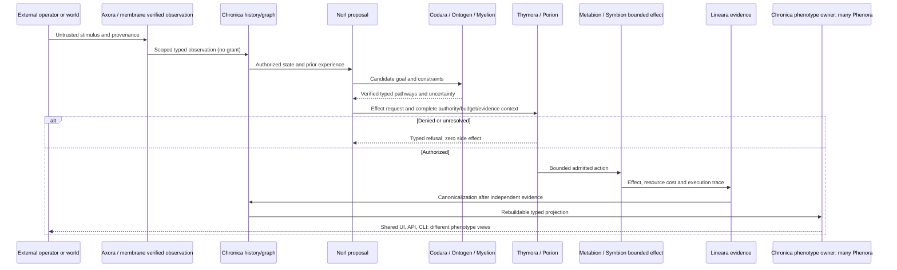
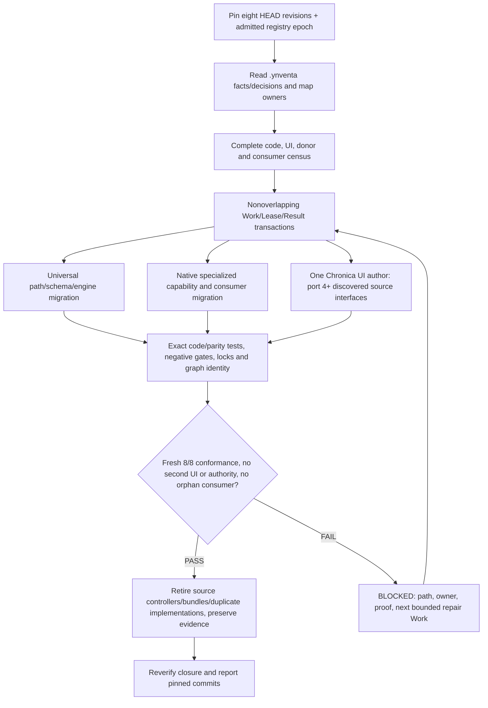

# Ynventa / Chronica — Evidence-Driven Convergence Work Prompt

Status: **CURRENT PROJECT WORKING PROMPT — never architecture authority by itself**

This is a copyable instruction for bounded multi-repository engineering work. **Canonical doctrine and decisions are admitted `.ynventa` facts**; nomenclature is the registered 21-concept Chronica registry; implemented behavior is code with a real caller, successful tests, authorized effects and recorded evidence. This Markdown never grants permission, claims a V1 milestone or creates a new source of truth. Its own placement under this temporary source checkout is not a permanent project-governance owner.

## North star

Build ONE graph-native **Chronica Digital Holobiont**, not a suite of independently authoritative domain services. Preserve **Chronica** and **Norl** as names; use the canonical Latin-inspired technologies from `Chronica/.ynventa/declared/nomenclature/concepts.jsonl` (DECISION 0115). All source checkouts are temporary capability-development locations that must converge into the single canonical semantic/execution universe.

**ONE BODY; ONE GENORA CONCEPT; MANY PHENORA; ONE UI IMPLEMENTATION OWNER.**

Convergence is measured by real elimination of duplicate authority, unnecessary independent code, fragmented frontend libraries, fractured source grammar, unverified donor dependencies, and conflicting evolution controllers. It must not erase unique optimizations, preserved identity, source evidence, money/device safety, or algorithmic capability.

## Canonical names (do not use generic biology as subsystem brands)

The registration keys CN-0001…CN-0021 have these exact names:

| Registered concept | Responsibility and constraints |
|---|---|
| **Ontogen** | Lawful capability/pathway composition; it proposes valid paths, does not execute or grant rights |
| **Myelion** | Mathematical evaluation distributed across capabilities; no standalone Myelion runtime is demonstrated |
| **Nomocyte** | State/transition and mathematical-invariant verification |
| **Genora** | Stable graph identity, inherited laws and capability potential; physical `genome/` remains a frozen path role |
| **Codara** | Typed semantic-intent language and compiler into candidate programs |
| **Axora** | Discover and verify bindings to unknown protocols/surfaces |
| **Somara** | Embodied/world/resource-state concept, home unresolved |
| **Homeora** | Homeostasis and service/resource regulation concept, home unresolved |
| **Thymora** | Authority, mandates and bounded grants |
| **Porion** | Pre-effect admission with explicit denial/unresolved precedence |
| **Metabion** | Admitted work, resource consumption and bounded execution |
| **Lineara** | Evidence, provenance, history and causal lineage |
| **Phenora** | Many observable expressions, read-only projections and shared UI/CLI/API surfaces |
| **Symbion** | External partner/effect contracts, never a separate authority |
| **Phylogena** | Technology ancestry, selection and transfer; no complete dedicated runtime demonstrated |
| **Alloma** | Conserved, justified cross-scale transitions |
| **Immunara** | Organism-wide distributed security/immune concerns; no fully unified immune system demonstrated |
| **Regena** | Evidence-driven trusted restoration concept; not a completed runtime |
| **Genesia** | Origin/reproduction of new canonical structures; not implemented as a complete runtime |
| **Apoptra** | Controlled termination and death semantics, partially represented |
| **Ecoria** | Ecology/multi-organism relationships, not a completed runtime |

A **concept is not a crate, root, service, graph node kind or an assertion of implementation**. Generic words such as Genome, Regulome, Epigenome, Proteome, Interactome, Metabolism and Phenome are explanatory functional vocabulary, not competing subsystem names. Never rename a machine-frozen NodeId source token, wire value, protocol lock, golden fixture, historical repository identity or provenance key as a cosmetic change. Authorized, identity-preserving migrations have their own explicit proof and cutover.

## Scope: all eight mandatory physical source checkouts

- `Chronica` — one canonical identity, graph, state, authority, evidence, runtime and all maintained product frontend code.
- `.Ynventa-` — transitionary centralized development/evolution engine, Work/Lease/Result, donor census and Foundry; not a second Chronica authority.
- `Esellios` — commerce and economic algorithm source, preserving exact-money/tenant/security/ERP guarantees.
- `Fi-game` — market/simulation/finance/risk source, preserving deterministic replay, exact financial invariants and risk refusal.
- `Mechatron` — device/twin/robotics/control source, preserving leases, interlocks, safety and real operator behavior.
- `Atlas-Studio` — compiler/tool/Studio source history; Codara concept, not an independent ongoing compiler regime.
- `Universal-Connector` — Axora-related protocols, verification and interaction source, not an independent connectivity authority.
- `ECDEV` — native acquisition, data extraction, crawl frontier, SQL store, donor history and independent `.ecdev` migration source, not an exempt eighth system.

Do not create or keep an alternative Host/Guest physical grammar. The common legal responsibility roots (instantiated **only if they contain real source**) are `genome/`, `physiology/`, `organism/`, `membrane/`, `symbiosis/`, `phenotype/`, `evolution/`, `assays/` and `.ynventa/`. Legal physical vocabulary is not a grant for all repositories to create independent ontology, frontend or runtime sovereignty. All unconverted `core/`, `substrate/`, `domain/`, `adapter/`, `apps/`, `tools/`, `tests/`, `research/` and `.ecdev/` implementation roots are **current migration inputs, NOT permitted final morphology**. Crate-local tests and external provenance fixtures are distinct from forbidden top-level implementation roots.

## Required single presentation owner

All maintained **product UI implementations** — TypeScript/TSX/JS components, HTML/CSS, design tokens, interactive views, studio/dashboard/robot operator code, chart renderers, presentation bundles — must converge into `Chronica/phenotype/`. This is ONE UI **code owner**, not ONE phenotype. Different Phenora can represent markets, commerce, robotics, design and product research using shared governed projection/interaction contracts.

Verified current UI migration sources include:

| Source checkout | Source UI | Required handling |
|---|---|---|
| ECDEV | `apps/web/` | Port/reuse required behavior in Chronica, verify Rust server consumer cutover, remove old bundle |
| Fi-game | `apps/frontend/` | Port/reuse financial expression, keep native risk/finance truth and refusal at owner |
| Mechatron | `apps/operator/` | Preserve typed `mechatron.site-view/2`, `mechatron.site-events/2`, read-only CSP, exact safety verdicts and `mechatron.operator-request/1` behavior |
| Atlas-Studio | `apps/studio/` | Port/reuse unique Studio interactions, remove duplicate component/design systems and build routes |

A backend HTTP service, web parser, research-only TypeScript oracle, device protocol or native computation is **not** automatically UI and must not be incorrectly deleted. UI cannot independently compute canonical trading permissions, economic/stock truth, physical control authorization or model admission. Every consequential action travels back through Chronica's Thymora/Porion before Metabion execution, followed by Lineara evidence.

## Working method: source revision first

1. **Read live facts** with the existing `ynventa context`, `ynventa knowledge view` and `ynventa fact list --kind decision` where available, then inspect the registered concepts/policy and code at each pinned HEAD. Do not use old origin-path Markdown as present authority.
2. **Build a full file/consumer census** for all eight repositories, including Cargo, scripts, TypeScript, HTML/CSS assets, tests, donor ledgers, `.ecdev` data and evidence. Label each artifact: actual runtime implementation, real consumer, unique native algorithm, UI migration source, research oracle, licensed donor, frozen identity or obsolete path.
3. **Resolve graph and code ownership before authoring**. Search Chronica's existing capability graph, `phenotype/chart-view`, Codara, Ontogen and named technology families. Reuse proven equivalent implementations. Keep legitimate optimized alternatives under one exact capability contract.
4. **Plan bounded Work** with explicit before/after paths, principal, write sets, leases, exact source revisions, independent owners, test oracles and rollback. Dispatch nonconflicting workers concurrently; never race on shared protocol lock or same files.
5. **Implement through code and real callers**. A declared node, compatibility of signatures, parsed donor or a candidate does not prove executable composition. A new requires edge must be selected, reached through a binary/API/CLI caller, authorized if effectful, and yield measured evidence.
6. **Reverify independently**: format/lint/test the relevant actual workspace; run exact producer/consumer negative tests, leakage/split rules where applicable, security/refusal, budget and retention, hardware-safe interlock checks, chart/UI security and accessibility, performance regression, link/lock convergence and replay.
7. **Migrate real consumers**, not just directories. Keep source history pinned while transitioning; remove duplicated old executable code, frontend builds, alternate control plane and stale links once evidence passes. Never destroy historical provenance or silently rewrite recorded identifiers.
8. **Update admitted facts and human-readable docs together**, with fresh exact revision/line/caller evidence. An agent cannot grant a missing owner decision or silently change V1 denominators. Record a typed blocker and assign repair Work when a requirement remains unresolved.

### Normal execution and authority loop

### Eight-repository migration coordinator

## No fabricated closure or inflated percentages

The V1 readiness contract is the **minimum of eight defined dimensions**; UNDEFINED counts as zero. Do not infer percentage from phase counts, size of docs or number of diagrams. The exact release gates and required donor cohort are subject to admitted owner decisions; do not treat an unapproved cohort of 11 proposal roots as accepted. Scoped donor extinction after independently verified native replacement is distinct from *every OSS anywhere* being extinct. A source UI bundle retired is **not** automatically donor extinction.

The following are not *automatically required* to claim bounded V1 under recorded scope: pretraining a frontier model, perfect brain simulation, all-world OSS extinction, replacing every cloud provider and unauthorized self-rewriting code. The fifth is **never a permitted execution path**, not an exciting future feature. The ambition to enable authorized evolution and self-hosting must pass Thymora/Porion/Lineara proof.

### Required per-Work status report

Every WorkResult must disclose:

| Field | Required content |
|---|---|
| Scope | Exact affected repositories, paths, concept CN IDs, source revisions |
| What changed | Actual code and consumers, not a spec-only promise |
| Reality status | DECLARED, PROPOSED, PARTIAL, REACHED, ADMITTED, EVIDENCED, BLOCKED or STALE; definitions and confidence explicit |
| Proof | Exact commands and results, negative/security tests, evidence revision, held-out data when applicable |
| Ownership | Canonical graph owner, physical source locations, destination and old consumer cutover |
| Migration closure | Current incompatible roots/controllers/UI bundles and which were actually retired |
| Failure | Exact reason, affected owner, rollback or next bounded Work |
| V1 measurement | Current eight-dimension values only if independently computed; otherwise UNKNOWN |

Never report 100% because a repository compiles, has thousands of tests, a donor is registered, all lines are native, or a diagram renders. A successful documentation-only Work is explicitly **DOCS-ONLY**; global code conformance remains unproven until the source/runtime migration and all relevant gates pass.

## Scope of this document

This prompt is not an alternative constitution, not an independent master scheduler, not a source of live capability maturity and not a replacement for `.ynventa` Work transactions. It exists to guide a verified, identity-preserving, authorized engineering wave under the one Chronica Digital Holobiont.
